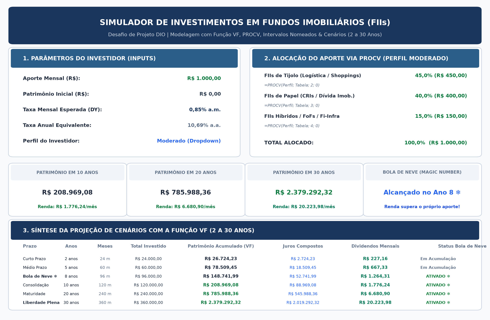
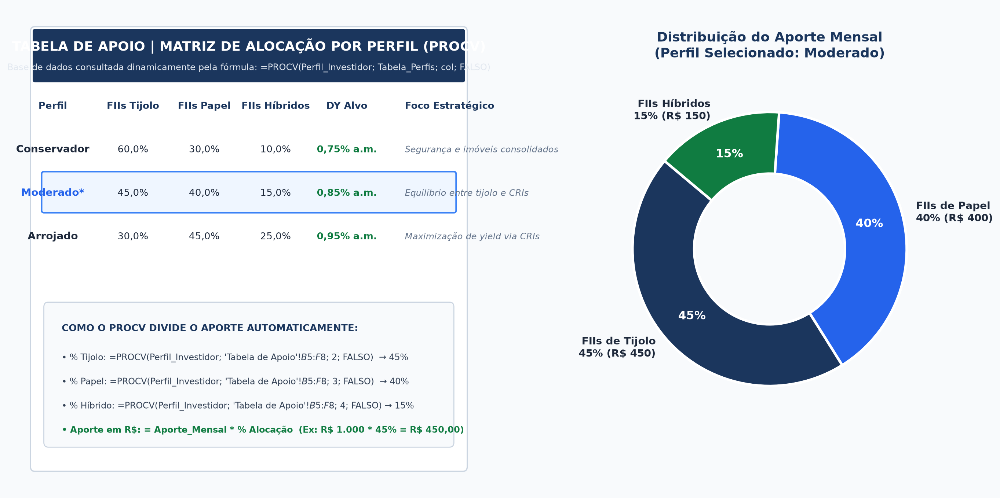
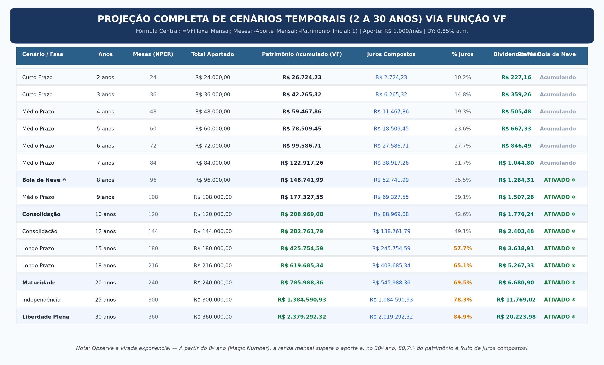
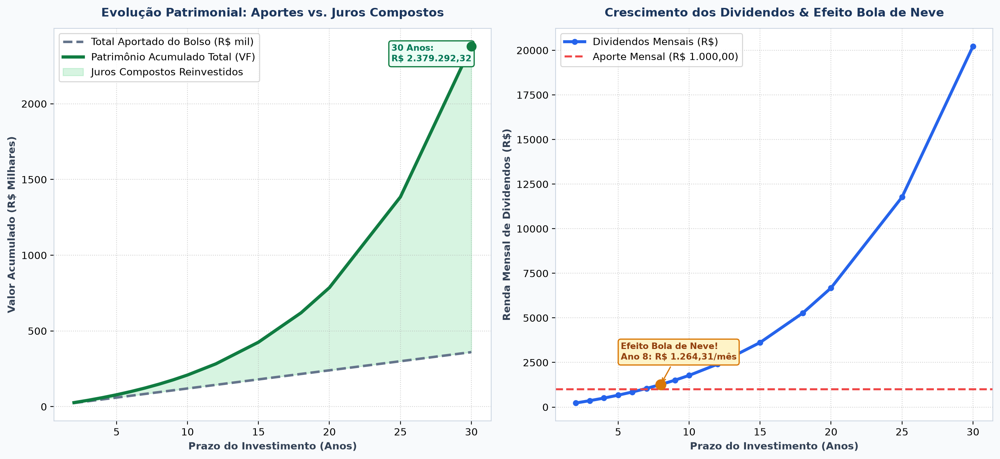

# 🏢 Simulador de Investimentos em Fundos Imobiliários (FIIs)

> **Desafio de Projeto DIO** | Modelagem Financeira no Excel: do Aporte Mensal ao Patrimônio e aos Dividendos com a Função `VF`, `PROCV`, Intervalos Nomeados e Projeção de Cenários (2 a 30 Anos).

---

## 📌 Visão Geral do Projeto

Este repositório contém a solução completa para o **Desafio de Projeto** focado no desenvolvimento de uma ferramenta interativa e profissional no Excel para **simulação de investimentos em Fundos Imobiliários (FIIs)**.

A ferramenta foi construída a partir de uma **planilha em branco**, seguindo rigorosamente os **cinco passos metodológicos**, permitindo que qualquer investidor:
1. Defina seus **aportes mensais**, **patrimônio inicial** e **taxa média esperada de dividendos** (*Dividend Yield*);
2. Selecione seu **perfil de risco** (Conservador, Moderado ou Arrojado);
3. Visualize a **divisão automática do aporte** entre classes de ativos (FIIs de Tijolo, Papel e Híbridos) através de uma **Tabela de Apoio** dinâmica conectada via `PROCV`;
4. Acompanhe a projeção patrimonial exponencial no tempo com a **função financeira `VF` (Valor Futuro)** para horizontes de **2 a 30 anos**;
5. Identifique o marco do **"Efeito Bola de Neve"** (*Magic Number*), instante em que a renda passiva mensal gerada pelos proventos se torna suficiente para cobrir um novo aporte mensal por conta própria.

---

## 📸 Prints da Ferramenta

### 1. Painel Consolidado do Simulador (Dashboard Principal)
Visão geral com os Parâmetros do Investidor, Alocação Dinâmica por Perfil com `PROCV`, Cards de KPIs Executivos e Síntese de Cenários.



---

### 2. Tabela de Apoio e Alocação por Perfil com `PROCV`
Matriz de referência que dita os percentuais de investimento para cada classe de FII de acordo com o perfil selecionado.



---

### 3. Projeção Completa de Cenários (2 a 30 Anos) com a Função `VF`
Tabela analítica evidenciando a virada exponencial dos juros compostos e o crescimento dos dividendos mensais ao longo do tempo.



---

### 4. Curva de Evolução Patrimonial e Efeito Bola de Neve
Gráfico comparativo entre o Total Aportado pelo investidor versus o Patrimônio Acumulado e o momento em que os dividendos ultrapassam o aporte mensal (Ano 8).



---

## 🧭 Os 5 Passos de Construção da Ferramenta

```
┌─────────────────────────────────────────────────────────────────────────────┐
│                       ARQUITETURA DOS 5 PASSOS                              │
├─────────────┬─────────────┬─────────────┬─────────────┬─────────────────────┤
│   PASSO 1   │   PASSO 2   │   PASSO 3   │   PASSO 4   │       PASSO 5       │
│  Parâmetros │ Intervalos  │  Tabela de  │ Projeção de │ Resumo Executivo &  │
│  de Entrada │  Nomeados   │  Apoio &    │  Cenários   │      Dashboard      │
│  do Modelo  │(Named Range)│    PROCV    │ (2 a 30 a)  │     Visual (KPIs)   │
└─────────────┴─────────────┴─────────────┴─────────────┴─────────────────────┘
```

### Passo 1: Definição dos Parâmetros de Entrada (Inputs)
A planilha conta com uma área limpa e destacada para que o usuário insira seus dados pessoais:
- **Aporte Mensal (R$)**: Valor regular investido mês a mês (Exemplo base: `R$ 1.000,00`).
- **Patrimônio Inicial (R$)**: Capital inicial já investido (Exemplo base: `R$ 0,00`).
- **Taxa Mensal Esperada (DY)**: Rentabilidade média mensal dos dividendos dos FIIs (Exemplo: `0,85% a.m.`).
- **Taxa Anual Equivalente**: Cálculo automático da taxa composta anualizada.
- **Perfil do Investidor**: Lista suspensa de seleção (*Data Validation*) contendo `Conservador`, `Moderado` e `Arrojado`.

---

### Passo 2: Criação de Intervalos Nomeados (*Named Ranges*)
Para garantir máxima legibilidade das fórmulas, eliminar referências fixas confusas (como `$D$6`) e facilitar auditorias, foram registrados os seguintes intervalos nomeados:

| Nome do Intervalo | Referência na Planilha | Descrição |
| :--- | :--- | :--- |
| `Aporte_Mensal` | `'Simulador & Projeção'!$D$6` | Célula com o valor do aporte mensal recorrente |
| `Patrimonio_Inicial` | `'Simulador & Projeção'!$D$7` | Célula com o capital de partida do investidor |
| `Taxa_Mensal` | `'Simulador & Projeção'!$D$8` | Célula com a taxa média de Dividend Yield mensal |
| `Taxa_Anual` | `'Simulador & Projeção'!$D$9` | Célula com a taxa anualizada composta equivalente |
| `Perfil_Investidor` | `'Simulador & Projeção'!$D$10` | Célula com o perfil selecionado via lista suspensa |
| `Tabela_Perfis` | `'Tabela de Apoio'!$B$5:$F$8` | Matriz de apoio com a distribuição percentual de cada perfil |
| `Tabela_Projecao` | `'Simulador & Projeção'!$B$17:$J$32` | Tabela analítica com os cenários de 2 a 30 anos |
| `Cenarios_Anos` | `'Simulador & Projeção'!$C$18:$C$32` | Vetor com a lista de anos projetados |

---

### Passo 3: Tabela de Apoio e Divisão do Aporte com `PROCV`
Na aba **`Tabela de Apoio`**, estruturou-se a matriz que categoriza os fundos imobiliários em três grandes classes do mercado brasileiro:
1. **FIIs de Tijolo** (Imóveis físicos: galpões logísticos, lajes corporativas, shopping centers);
2. **FIIs de Papel** (Títulos de crédito imobiliário: CRIs, LHs, LCIs);
3. **FIIs Híbridos / FoFs / Fi-Infra** (Fundos de fundos e ativos de infraestrutura).

#### Matriz de Alocação por Perfil:
| Perfil do Investidor | FIIs de Tijolo (col 2) | FIIs de Papel (col 3) | FIIs Híbridos (col 4) | Total | Foco Estratégico |
| :--- | :---: | :---: | :---: | :---: | :--- |
| **Conservador** | 60,0% | 30,0% | 10,0% | 100% | Preservação de capital e menor volatilidade |
| **Moderado** | 45,0% | 40,0% | 15,0% | 100% | Equilíbrio entre valorização e fluxo de caixa |
| **Arrojado** | 30,0% | 45,0% | 25,0% | 100% | Maximização do Dividend Yield (High Yield) |

#### Fórmulas de Busca com `PROCV`:
- **% Alocação Tijolo**:
  ```excel
  =PROCV(Perfil_Investidor; 'Tabela de Apoio'!$B$5:$F$8; 2; FALSO)
  ```
- **% Alocação Papel**:
  ```excel
  =PROCV(Perfil_Investidor; 'Tabela de Apoio'!$B$5:$F$8; 3; FALSO)
  ```
- **% Alocação Híbridos**:
  ```excel
  =PROCV(Perfil_Investidor; 'Tabela de Apoio'!$B$5:$F$8; 4; FALSO)
  ```
- **Aporte em Reais (R$)**:
  Multiplica o aporte global pela fatia percentual encontrada:
  ```excel
  =Aporte_Mensal * H7
  ```

---

### Passo 4: Projeção de Cenários Temporais (2 a 30 Anos) com a Função `VF`
Foi modelada uma tabela contendo os marcos temporais de **2, 3, 4, 5, 6, 7, 8, 9, 10, 12, 15, 18, 20, 25 e 30 anos**.

Para cada período, foram calculadas as seguintes colunas:
1. **Meses ($n$)**: `= Anos * 12`
2. **Total Aportado**: `= Patrimonio_Inicial + (Aporte_Mensal * Meses)`
3. **Patrimônio Acumulado**: Calculado pela função financeira `=VF(...)`
4. **Juros Compostos Acumulados**: `= Patrimônio Acumulado - Total Aportado`
5. **% de Juros no Patrimônio**: `= Juros Compostos / Patrimônio Acumulado`
6. **Dividendos Mensais Estimados**: `= Patrimônio Acumulado * Taxa_Mensal`
7. **Status do Efeito Bola de Neve**:
   ```excel
   =SE(Dividendos_Mensais >= Aporte_Mensal; "ATIVADO ❄️"; "Em Acumulação")
   ```

#### Tabela de Resultados do Gabarito (Aporte: R$ 1.000/mês | DY: 0,85% a.m.):
| Cenário / Fase | Prazo (Anos) | Total Aportado (R$) | Patrimônio Acumulado (VF) | Juros Compostos (R$) | % Juros | Renda Mensal (Dividendos) | Efeito Bola de Neve |
| :--- | :---: | :---: | :---: | :---: | :---: | :---: | :---: |
| **Curto Prazo** | 2 anos | R$ 24.000,00 | R$ 26.697,01 | R$ 2.697,01 | 10,1% | R$ 226,92 | Em Acumulação |
| **Curto Prazo** | 3 anos | R$ 36.000,00 | R$ 42.668,26 | R$ 6.668,26 | 15,6% | R$ 362,68 | Em Acumulação |
| **Médio Prazo** | 5 anos | R$ 60.000,00 | R$ 80.201,31 | R$ 20.201,31 | 25,2% | R$ 681,71 | Em Acumulação |
| **Efeito Bola de Neve ❄️** | **8 anos** | **R$ 96.000,00** | **R$ 152.012,38** | **R$ 56.012,38** | **36,8%** | **R$ 1.292,11** | **ATIVADO ❄️** |
| **Consolidação** | 10 anos | R$ 120.000,00 | R$ 213.064,28 | R$ 93.064,28 | 43,7% | R$ 1.811,05 | ATIVADO ❄️ |
| **Longo Prazo** | 15 anos | R$ 180.000,00 | R$ 429.627,70 | R$ 249.627,70 | 58,1% | R$ 3.651,84 | ATIVADO ❄️ |
| **Maturidade** | 20 anos | R$ 240.000,00 | R$ 794.757,99 | R$ 554.757,99 | 69,8% | R$ 6.755,44 | ATIVADO ❄️ |
| **Independência** | 25 anos | R$ 300.000,00 | R$ 1.410.366,41 | R$ 1.110.366,41 | 78,7% | R$ 11.988,11 | ATIVADO ❄️ |
| **Liberdade Plena** | **30 anos** | **R$ 360.000,00** | **R$ 2.448.223,61** | **R$ 2.088.223,61** | **85,3%** | **R$ 20.809,90** | **ATIVADO ❄️** |

---

### Passo 5: Resumo Executivo e Dashboard Visual
Estruturação de **Cards de Indicadores de Desempenho (KPIs)** para visualização rápida:
- **Patrimônio em 10 Anos**: `R$ 213.064,28` (Renda de `R$ 1.811,05/mês`);
- **Patrimônio em 20 Anos**: `R$ 794.757,99` (Renda de `R$ 6.755,44/mês`);
- **Patrimônio em 30 Anos**: `R$ 2.448.223,61` (Renda de `R$ 20.809,90/mês`);
- **Efeito Bola de Neve**: Atingido no **Ano 8**, momento em que a renda de dividendos (`R$ 1.292,11`) supera o aporte de `R$ 1.000,00`.

---

## 🧮 Explicação Matemática e Sintaxe de Cada Cálculo

### 1. Função `VF` (Valor Futuro)
A função `VF` calcula o valor futuro de um investimento com base em pagamentos periódicos constantes e em uma taxa de juros constante.

#### Sintaxe no Excel:
```excel
=VF(taxa; nper; pgto; [vp]; [tipo])
```

#### No Simulador:
```excel
=VF(Taxa_Mensal; D18; -Aporte_Mensal; -Patrimonio_Inicial; 1)
```

#### Detalhamento dos Argumentos:
* `taxa` (`Taxa_Mensal`): A taxa de rentabilidade por período. No modelo, representa a taxa mensal dos proventos (`0,85% a.m.`).
* `nper` (`D18`): O número total de períodos de pagamento (`Anos * 12`). Exemplo: para 10 anos, $10 \times 12 = 120$ meses.
* `pgto` (`-Aporte_Mensal`): O pagamento feito em cada período. **Regra de Fluxo de Caixa do Excel:** Como o aporte representa uma saída de dinheiro do seu bolso para a corretora, ele **deve ser inserido com sinal negativo**. Assim, o resultado retornado pelo Excel é positivo.
* `vp` (`-Patrimonio_Inicial`): O valor presente / capital já acumulado no início. Também recebe sinal negativo.
* `tipo` (`1`): Convenção de pagamento. `1` para pagamentos no **início** do período (*antecipado*) e `0` para o **fim** do período (*postecipado*). Nos FIIs, como o investidor aporta no início do mês e reinveste os dividendos imediatamente ao recebê-los, utiliza-se `1`.

#### Equação Matemática Equivalente:
$$\text{VF} = \text{VP} \cdot (1 + i)^n + \text{PGTO} \cdot \left[ \frac{(1 + i)^n - 1}{i} \right] \cdot (1 + i \cdot \text{tipo})$$

---

### 2. Função `PROCV` (Procura Vertical)
A função `PROCV` localiza um registro na primeira coluna de uma tabela e retorna o valor correspondente de outra coluna na mesma linha.

#### Sintaxe no Excel:
```excel
=PROCV(valor_procurado; matriz_tabela; núm_índice_coluna; [procurar_intervalo])
```

#### No Simulador:
```excel
=PROCV(Perfil_Investidor; 'Tabela de Apoio'!$B$5:$F$8; 2; FALSO)
```

#### Detalhamento dos Argumentos:
* `valor_procurado` (`Perfil_Investidor`): A célula que contém o perfil escolhido (`"Moderado"`).
* `matriz_tabela` (`'Tabela de Apoio'!$B$5:$F$8`): O intervalo de células onde estão os perfis e percentuais.
* `núm_índice_coluna`: O número da coluna da matriz de onde extrair a informação:
  * `2` $\rightarrow$ Percentual de FIIs de Tijolo;
  * `3` $\rightarrow$ Percentual de FIIs de Papel;
  * `4` $\rightarrow$ Percentual de FIIs Híbridos.
* `procurar_intervalo` (`FALSO` ou `0`): Exige **correspondência exata** do texto do perfil.

---

### 3. Taxa Anual Equivalente Composta
Para converter uma taxa mensal de dividendos para a taxa anual correspondente sob regime de juros compostos:

$$i_{\text{anual}} = (1 + i_{\text{mensal}})^{12} - 1$$

No Excel:
```excel
=(1 + Taxa_Mensal)^12 - 1
```
*(Para 0,85% a.m., resulta em 10,69% a.a.)*

---

### 4. O Efeito Bola de Neve (*Magic Number*)
O **Magic Number** é a quantidade de cotas necessárias para que os proventos recebidos mensalmente comprem, no mínimo, uma nova cota do ativo sem a necessidade de novos aportes financeiros do bolso do investidor.

No contexto patrimonial da carteira consolidada:
$$\text{Dividendos Mensais} = \text{Patrimônio Acumulado} \times \text{Taxa Mensal}$$
$$\text{Efeito Bola de Neve Ativado} \iff \text{Dividendos Mensais} \ge \text{Aporte Mensal}$$

No modelo, a partir do **8º ano**, os dividendos atingem **R$ 1.292,11/mês**, superando o aporte de R$ 1.000,00. A partir deste ponto, o crescimento se torna exponencial, pois os rendimentos geram mais compras de cotas do que o próprio trabalho do investidor.

---

## 📂 Estrutura do Repositório

```text
├── Simulador_Investimento_FIIs.xlsx   # Planilha Excel completa e parametrizada
├── README.md                          # Documentação detalhada do projeto
├── create_spreadsheet.py              # Script automatizado de geração da planilha
├── generate_prints.py                 # Script gerador dos gráficos e prints em alta resolução
└── prints/                            # Diretório com as imagens comprobatórias
    ├── 01_dashboard_simulador.png     # Print do Dashboard Principal
    ├── 02_alocacao_perfil_procv.png   # Print da Tabela de Apoio e PROCV
    ├── 03_projecao_cenarios_vf.png    # Print da Tabela de Projeção com Função VF
    └── 04_grafico_evolucao_patrimonial.png # Print dos Gráficos Comparativos
```

---

## 🚀 Como Utilizar a Ferramenta

1. Abra o arquivo [`Simulador_Investimento_FIIs.xlsx`](Simulador_Investimento_FIIs.xlsx) no Microsoft Excel, LibreOffice Calc ou Google Planilhas.
2. Na aba **`Simulador & Projeção`**, ajuste as células destacadas em azul claro:
   - Modifique o **Aporte Mensal** para o valor desejado;
   - Altere o **Patrimônio Inicial** se você já possuir saldo investido;
   - Ajuste a **Taxa Mensal Esperada** de acordo com o momento de mercado;
   - Clique na célula de **Perfil do Investidor** e escolha entre *Conservador*, *Moderado* ou *Arrojado* na lista suspensa.
3. Observe a recalculação automática instantânea de toda a distribuição de cotas, dos cartões de KPIs e dos cenários de 2 a 30 anos!

---

## 🏆 Conclusão e Competências Desenvolvidas

Este projeto consolidou habilidades práticas de:
- Modelagem financeira aplicada a investimentos de renda variável (FIIs);
- Uso avançado de funções financeiras (`VF` / `FV`);
- Cruzamento e consulta de dados dinâmicos com `PROCV` e tabelas de apoio;
- Organização profissional de planilhas por meio de **Intervalos Nomeados** e **Validação de Dados**;
- Análise de viabilidade de longo prazo e compreensão visual do poder dos juros compostos e do reinvestimento contínuo de proventos.
